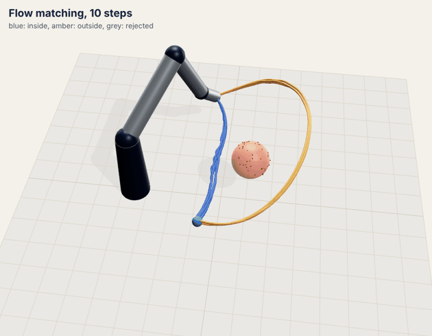
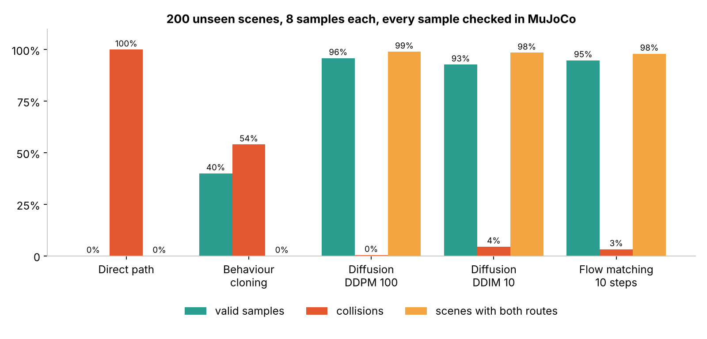
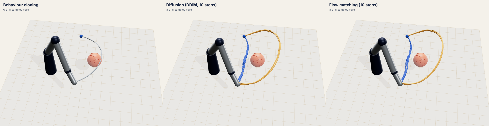
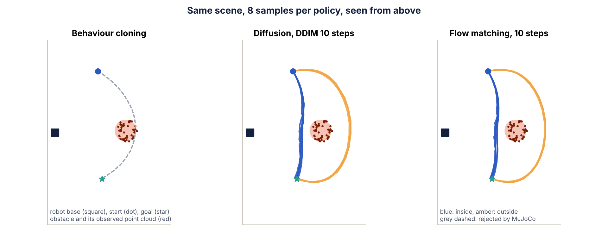
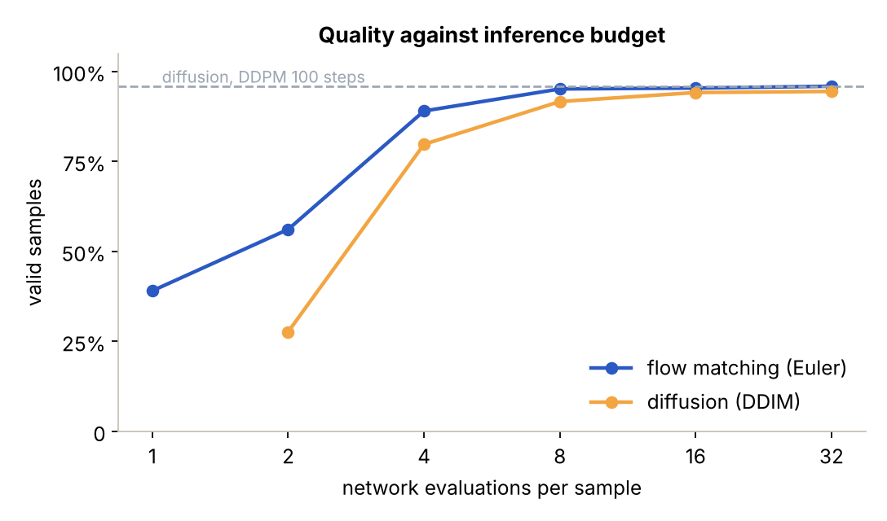
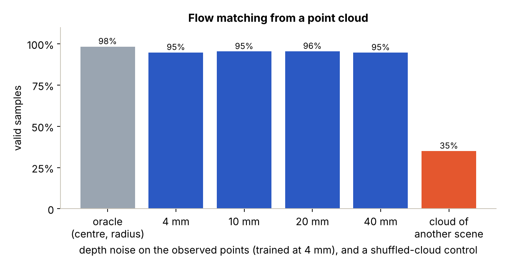

# motion-flow-lab

**Flow matching vs diffusion vs behaviour cloning for obstacle-aware motion generation, from a point cloud, checked in MuJoCo.**

   

<p align="center"></p>

A robot arm must reach a goal behind an obstacle it only sees as a noisy point cloud. There are two equally good
answers: pass **inside** (between the obstacle and the base) or **outside**. The expert data contains both, for every
scene. This is the smallest setting where the choice of generative model matters:

* **Behaviour cloning** regresses the mean of the two answers, which goes through the obstacle or picks a single side.
* **Diffusion** and **flow matching** learn the distribution, so each sample commits to one route and the two routes
  appear in almost every scene.

Every generated trajectory is replayed and judged by **MuJoCo** (exact geometric distances on interpolated substeps,
joint limits, table, goal tolerance of 2 cm). No metric comes from the training model itself.

## Results

200 unseen scenes, 8 samples per scene and policy (1,600 trajectories per row), CPU, same backbone and training budget
(8,000 steps) for the three learned policies.

| Policy | Valid samples | Collisions | Scenes with both routes | Median goal error | Latency (8 samples) |
|---|---:|---:|---:|---:|---:|
| Direct path (joint-space line) | 0.0% | 100% | 0% | 1.0 mm | n/a |
| Behaviour cloning | 40.0% | 54.0% | 0% | 12.3 mm | 1.5 ms |
| Diffusion, DDPM 100 steps | **95.9%** | **0.4%** | **99.0%** | 9.1 mm | 88.0 ms |
| Diffusion, DDIM 10 steps | 92.7% | 4.5% | 98.5% | 8.8 mm | 9.7 ms |
| **Flow matching, 10 steps** | 94.8% | 3.3% | 98.0% | **7.9 mm** | **7.5 ms** |



<p align="center"></p>
<p align="center"></p>

**Inference budget.** Flow matching reaches the 100-step DDPM quality with 8 network evaluations (95.1%) and is ahead of
DDIM at every budget; with 4 evaluations it keeps 89.0% against 79.7%. This is the practical argument for flow matching
on a robot: an order of magnitude fewer evaluations for the same quality.



**Perception.** The policy reads a 48-point cloud of the visible half of the obstacle (PointNet encoder). Given the
true centre and radius instead (oracle), flow matching reaches 98.4%, so perception costs about 3.6 points. Depth noise
up to 40 mm at test time does not change the result (94.7% to 95.5%). The control matters more than the noise sweep:
feeding the cloud of **another** scene drops success to 35%, so the policy does use what it sees.



## What is in the box

```
mfl/robot.py      4-DoF arm: differentiable kinematics and exact capsule-sphere clearance (PyTorch), MuJoCo referee
mfl/scenes.py     random scenes, batched IK, simulated depth-camera point cloud
mfl/demos.py      expert trajectories by optimisation, two homotopy classes per scene, MuJoCo verdict
mfl/models.py     shared FiLM residual MLP; behaviour cloning, DDPM/DDIM (v-prediction), conditional flow matching
mfl/data.py       dataset, trajectory normalisation
mfl/train.py      AdamW, one-cycle, gradient clipping, EMA
mfl/evaluate.py   sampling, scoring, latency
experiments/run_all.py   the whole study, about 20 minutes on a 2-core CPU
tools/figures.py, tools/render.py, tools/viewer.html     figures, three.js renders and the GIF
tests/            8 tests, including FK and distances against MuJoCo and the two-mode claim on a toy problem
```

**Robot.** Base yaw and three pitch joints (links 0.35 / 0.30 / 0.12 m), modelled as capsules. Forward kinematics in
PyTorch matches MuJoCo to 1e-9 m; the arm-obstacle distance is computed exactly (closest point on each capsule axis)
and matches `mj_geomDistance` to 1e-6 m, so the optimiser and the referee agree.

**Demonstrations.** For each scene, a 32-waypoint trajectory is optimised twice (Adam, 700 iterations), once through a
via point inside the obstacle and once outside. Costs: goal, smoothness, velocity, collision hinge with a 3 cm margin,
joint limits, table. A scene is kept only if both solutions pass MuJoCo: 2,500 of 2,500 training scenes, 5,000
trajectories.

**Policies.** All three predict the 31 x 4 standardised joint offsets from the start configuration, conditioned on the
start configuration, the goal and the point cloud. Same backbone (width 256, 4 FiLM blocks), same optimiser, same steps.

* Behaviour cloning: mean squared error.
* Diffusion: cosine schedule, K = 100, v-prediction; ancestral DDPM or deterministic DDIM.
* Flow matching: straight path x_t = (1 - t) noise + t data, velocity target data - noise, Euler integration.

## Run it

```bash
pip install -r requirements.txt
pytest -q                               # 8 tests, about 30 s
python -m experiments.run_all --quick   # smoke run, about 3 min
python -m experiments.run_all           # full study, about 20 min, writes results/summary.json
python -m tools.figures                 # docs/figures/*.png
cd tools && npm i three@0.160.0 playwright && cd .. && python -m tools.render   # 3D renders and GIF
```

## Limits, stated plainly

* A 4-DoF arm and a single spherical obstacle, not a humanoid and not a cluttered scene. The point is a controlled
  comparison where the ground truth is exact, not scale.
* Demonstrations come from an optimiser, not from people or motion capture; the two routes are balanced by design
  (the generative policies sample inside about 49% of the time, as in the data).
* The obstacle lies between start and goal by construction, so its rough position is partly predictable from the task
  itself; the shuffled-cloud control above shows the observation is still used.
* Open loop: a whole trajectory is generated, then executed. Receding-horizon replanning and action chunking are the
  natural next step, as is a whole-body humanoid model from MuJoCo Menagerie.
* One seed per policy; differences of one or two points between diffusion and flow matching at high budget are within
  what a second seed could change.

## Learnt along the way

The first diffusion version predicted the noise (epsilon). At the noisiest level of a cosine schedule the signal weight
is about 0.003, so any error in the predicted noise is multiplied by about 300 when the clean trajectory is recovered,
and sampling diverged (0% valid). Switching to v-prediction fixed it without changing anything else: a reminder that
the parametrisation is part of the model, not a detail.

## License

MIT
